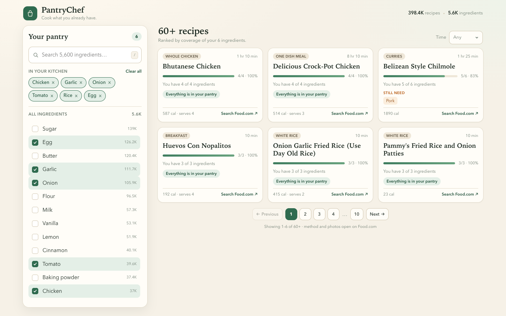

# PantryChef

Tell it what is already in the kitchen. It ranks **398,380 recipes** by how much
of each one you can cook right now, then links out to the source for the method.



Most recipe apps start with a search box and a wall of meals that need a
shopping trip. PantryChef starts with your pantry and sorts by coverage: a
5-of-6 match beats a 2-of-4 match, and recipes you can cook immediately sit at
the top. No invented instructions, no scraped photos — just the facts and a
link to Food.com.

## Stack

| Piece | Technology | Dev port |
| --- | --- | --- |
| Database | PostgreSQL 17 (398k recipes, 5,629 ingredients, 3.49M links) | 5432 |
| API | Node 22, Fastify 5, TypeScript, `pg` | 8080 |
| Web | React 19, Vite, TanStack Query | 5173 |
| Edge | Caddy 2 with a local (self-signed) CA | 80/443 |

## Repository layout

```
api/                      Fastify service: routes, SQL, tests
web/                      React client
db/migrations/            schema, applied in order
db/migrate.sh             idempotent migration runner
db/load.sh                load generated COPY files into any Postgres
db/fixtures.sql           deterministic dataset for API tests
Tools/build_postgres.py   raw CSV → COPY files → Postgres
deploy/                   Caddyfile and the web image
docker-compose.yml        db + api + caddy for the VPS
archive/ios-pantrychef/   shelved iOS prototype, kept for reference
```

## Local quickstart

Requires Node 22+, PostgreSQL 17, Python 3.10+, and about 1.2 GB of free disk
for the raw dataset plus the built database.

### 1. Get the raw dataset

The source is the Food.com mirror on Hugging Face:

```bash
mkdir -p data/raw
curl -L -o data/raw/foodcom_full.csv \
  https://huggingface.co/datasets/Karo8870/food.com-parsed-dataset/resolve/main/parsed_recipes.csv
```

If the filename changes, download `parsed_recipes.csv` from
<https://huggingface.co/datasets/Karo8870/food.com-parsed-dataset> and save it at
`data/raw/foodcom_full.csv`. Files in `data/raw/` are gitignored.

### 2. Build the database

```bash
brew install postgresql@17
brew services start postgresql@17

createdb pantry
DATABASE_URL=postgres://localhost/pantry bash db/migrate.sh
DATABASE_URL=postgres://localhost/pantry python3 Tools/build_postgres.py
```

The build streams the 651 MB CSV once, writes four COPY files to `build/`, and
loads them. It takes roughly 70 seconds on a laptop and is safe to re-run.

Already have the COPY files on another machine? Skip the Python step and run
`DATABASE_URL=... bash db/load.sh`.

### 3. Run the API

```bash
cd api
npm install
DATABASE_URL=postgres://localhost/pantry npm run dev
```

Check it:

```bash
curl localhost:8080/health
# {"status":"ok","database":"ok"}
```

### 4. Run the web client

```bash
cd web
npm install
npm run dev
```

Open <http://localhost:5173>. Vite proxies `/v1` and `/health` to port 8080.
Pantry selections and the open recipe are kept in the URL (`?pantry=16,5,7`),
so a list of ingredients can be shared.

## API

| Method | Path | Purpose |
| --- | --- | --- |
| GET | `/health` | API and database liveness |
| GET | `/v1/ingredients` | Browse or search the controlled vocabulary |
| GET | `/v1/categories` | Recipe categories with counts |
| GET | `/v1/meta` | Catalogue totals and group names |
| POST | `/v1/match` | Rank recipes for a set of ingredient ids |
| GET | `/v1/recipes/:id` | Ingredient lines and metadata for one recipe |

Ingredient list parameters: `q`, `limit` (≤6000), `offset`, `group`, and
`includeStaples`. Staples (`salt`, `pepper`, `water`, `oil`) are hidden by
default because every kitchen is assumed to have them.

Matching example:

```bash
curl -s localhost:8080/v1/match \
  -H 'content-type: application/json' \
  -d '{"ingredients":[16,5,7,14,93,3],"limit":3}'
```

```json
{
  "selected": 6,
  "minMatched": 3,
  "ignored": { "staples": [], "unknown": [] },
  "results": [
    {
      "id": 39337,
      "name": "Bhutanese Chicken",
      "minutes": 70,
      "nIngredients": 4,
      "matched": 4,
      "coverage": 1,
      "missing": [],
      "missingCount": 0,
      "sourceUrl": "https://www.food.com/search/Bhutanese+Chicken"
    }
  ]
}
```

Optional body fields: `minMatched`, `maxMinutes`, `categoryId`, `limit` (≤100).

### How ranking works

1. Count how many selected ingredients each recipe contains.
2. Require at least `minMatched` hits (default: 3, or all of them if fewer were
   selected).
3. Order by `2 × matched − n_ingredients` — the net number of ingredients the
   pantry saves you — then by coverage, matched count, and cooking time.
4. Drop recipes with fewer than three non-staple ingredients, and staple
   ingredients never count toward a match.

This rewards recipes that use a lot of what you have without letting a
two-ingredient sauce dominate the list. On the full catalogue a match request
runs in roughly 80–130 ms with `work_mem = 64MB`; the API sets `work_mem` per
connection (`DB_WORK_MEM`).

## Data and legal notes

The dataset is a mirror of Food.com's public recipe dump. PantryChef stores
**facts only**: recipe name, ingredient lines, quantities, nutrition numbers,
times, servings, and category. It does not store or show instructions, images,
authors, or descriptions. The "Food.com" link is the path to the method.

- 398,380 recipes after name deduplication and tail control (ingredients must
  appear in at least 20 recipes; each recipe needs at least 3 known ones).
- 31.5% of recipes have a numeric Food.com id embedded in their image path, so
  they link directly. Food.com redirects any slug to the canonical page for an
  id, which is why `https://www.food.com/recipe/x-<id>` works.
- The remaining recipes link to a Food.com search for the recipe name.
- The dataset is used without an explicit licence from Food.com. This is the
  acknowledged legal risk of the project; do not republish the corpus, and
  expect to revisit the arrangement before any commercial launch.

## Tests

```bash
cd api
npm test
```

The suite creates or refreshes `pantry_test`, applies migrations, loads
`db/fixtures.sql`, and exercises ranking, staple handling, filtering, and
error paths through Fastify's `inject`. Thirteen tests; no network needed.

## Deployment

See [`DEPLOY.md`](DEPLOY.md) for the Docker Compose + Caddy setup. The stack is
designed for a single small VPS with a self-signed certificate until a domain
and real certificate are available.

## Roadmap

- Accounts, saved pantries, and favourite recipes/ingredients (the schema in
  `db/migrations/002_users.sql` already has a home for them).
- Interaction events (`view`, `save`, `cook`) feeding recommendations.
- Optional generated method text, clearly labelled as AI-written, so the app is
  useful even when the source link rots.
- Grocery-list export from the `missing` fields.

## The iOS prototype

An earlier SwiftUI version lives in [`archive/ios-pantrychef/`](archive/ios-pantrychef/README.md)
and is tagged `ios-v0.1-archived`. It was shelved because TheMealDB's 790-meal
catalogue was far too small for ingredient matching; the web version uses the
full Food.com catalogue instead.
